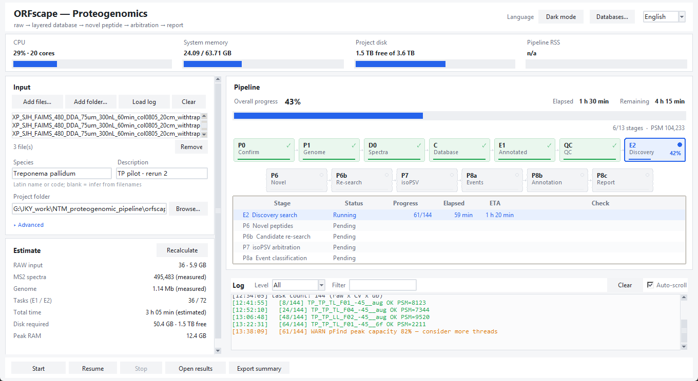
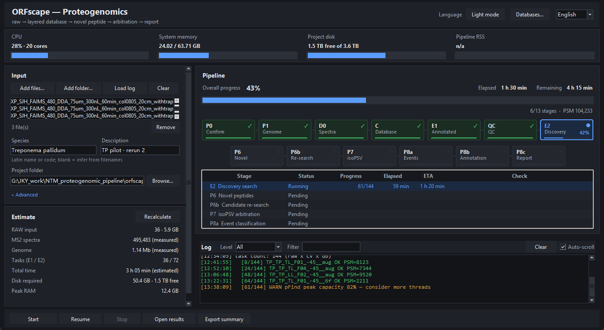
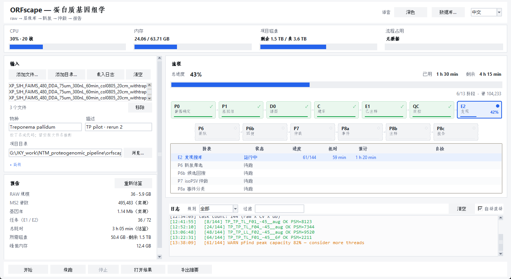
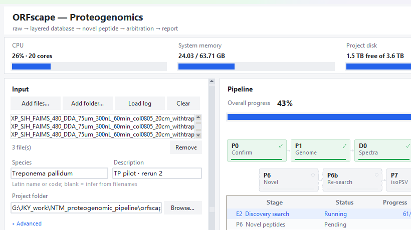
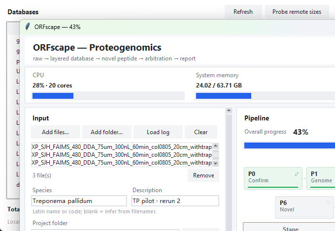

# ORFscape GUI（图形界面）

> 界面语言默认 **English**，右上角 `Language` 可切 **中文**。
> 界面只做两件事：把输入交出去、把运行读回来——真正的计算全在
> `python -m orfscape run` 子进程里，日志与进度都是文件，关掉界面不影响跑批。







---

## 1. 启动

```bash
cd ORFscape
python -m orfscape gui                 # 或 python -m orfscape.gui
python -m orfscape gui --workdir <已有项目>   # 预填并自动接管该项目日志
```

依赖：Python ≥ 3.9 + 标准库 tkinter（Windows 官方/conda 版自带），**不需要** PyQt/浏览器。
估算与数据库大小探测用到 PIL 只在截图脚本里；界面本身不需要 Pillow。

---

## 2. 界面分区

| 区域 | 内容 | 说明 |
|---|---|---|
| 顶栏 | 标题 / `Dark mode`·`Light mode` / `Databases…` / `Language` | 主题与语言切换即时生效，都写进 `~/.orfscape_gui.json` |
| 资源条 | CPU、内存、项目盘、Pipeline RSS | 1.5 s 采样；Windows 走 ctypes，Linux 走 `/proc`，取不到显示 `n/a` |
| **1 · Input** | RAW 列表、物种、描述、项目目录 | `Add files…` 选 raw 文件，`Add folder…` 选目录（递归找 `.raw`） |
| **Estimate** | RAW 规模、MS2 数、基因组、任务数、总耗时、磁盘、峰值内存 | 每项标注 `measured` / `estimated` / `calibrated` |
| **2 · Pipeline** | 阶段看板 + 总进度 + 当前阶段 + 明细表 | 看板点一下 = 日志按该阶段过滤；鼠标悬停显示该阶段的状态/进度/已用 vs 预计/自检 |
| **Log** | 实时日志、级别过滤（All / Warnings+ / Errors）、关键字过滤、`Ctrl+F` 搜索、右键菜单、自动滚动 | 数据来自事件流，不是抓子进程 stdout；右键可复制/按选中文本过滤/打开日志文件 |
| 底栏 | `Start` / `Resume` / `Stop` / `Open results` / `Export summary` | 结果按钮自动定位 `P13_results`→`08_report`→项目根；导出写 `00_logs/summary_<stamp>.csv`；右侧显示状态（失败标红并写明阶段） |

`Advanced ▸` 收起着：开始前确认、pFind 线程、回搜并发、发现库后缀、字号（90/100/115/130%）、
跳过 P6b/QC、强制重跑。

快捷键：`Ctrl+Enter` 开始、`Esc` 停止（焦点在输入框时不触发）、`Ctrl+O` 加文件、
`Ctrl+D` 数据库窗口、`Ctrl+F` 日志内查找、`Ctrl+Shift+C` 复制整份日志、`Ctrl+L` 跳到过滤框、
`F5` 重算估算并刷新数据库。窗口尺寸/位置、语言、主题、字号、过滤词与级别都会记住。

---

## 3. 一次典型运行

1. `Add folder…` 选 raw 目录 → 下方显示 `36 file(s) · 5.9 GB`；
2. 物种填 `Treponema pallidum`（留空则按文件名推断；填 `TP` 这类代码也行）；
3. 项目目录留空 → 自动建 `ORFscape/orfscape_projects/proj_<时间戳>`；
4. `Start` —— 先弹 **Run plan**：列出这轮要执行的命令、已完成的阶段标 `[skip]`，
   顶部是预计耗时 / 磁盘 / 峰值内存；确认后才真跑（`Advanced` 里可关掉这个确认）。

开跑后：

- 顶部总进度按**阶段权重**加权（E2 权重最大），不是阶段个数；
- 当前阶段显示 `E2 · 61/144 task`；
- `Remaining` 先给先验估计，两个采样点之后换成实测速率（`runtime = done/elapsed`）；
- 每个阶段跑完自动过一遍产物自检，表里 `Check` 列显示 `0F/0W`；
- 失败即停：出问题的阶段显示 `✕`，未跑的阶段标 `Not run`，总进度只到实际完成的位置
  （失败的阶段按已完成的子任务比例计，不算满）；
- 结束时响一声，状态栏写明完成用时或失败阶段；
- 进度同时写到**标题栏**（`ORFscape — 43%`）：Windows 上若任务栏支持 `ITaskbarList3`
  就画在任务栏图标上（成功绿条、失败变红、中断暂停），不支持则只有标题这一种显示。

`Stop` 写 `00_logs/stop.flag`，编排器在行边界收尾（15 s 内没停就 `taskkill /T`）。
`Resume` 从第一个不是 `Done`/`Skipped` 的阶段续跑。

---

## 4. 接管已有日志（agent / skill 跑的）

界面不区分"谁启动的"，只读文件：

```
<项目>/00_logs/progress.jsonl     ← 结构化事件（JSONL，一行一个）
<项目>/00_logs/run_<stamp>.log    ← 同一套文字日志
<项目>/00_logs/calibration.json   ← 实测阶段耗时，供下次预估
```

`Load log` 或直接填项目目录，界面会把历史事件回放成阶段状态。所以：

- 用 skill/agent 跑：`python .zcode/skills/orfscape-proteogenomics/scripts/run_pipeline.py …`
  现在会委派给包内编排器，**同样写 `progress.jsonl`**，界面可以直接接管；
- 纯命令行跑：`python -m orfscape run …`，同上；
- 断网/关机后重开界面，历史进度仍在。

---

## 5. 资源与数据库估算

**Estimate 卡**回答"这台机器吃不吃得下"：

| 指标 | 来源 |
|---|---|
| RAW 规模 / MS2 数 | 有 `00_input/raw_info.tsv` 就用实测，否则按 82,170 MS2/GB（TP 实测标定）估 |
| 基因组 | `01_genome/*/genomic.fna` 实测；没有则按 4 Mb 假设（标注 `assumed`） |
| 任务数 | E1 = MGF 数；E2 = MGF × 库数 |
| 总耗时 | 上次跑完的实测（`calibration.json`）优先；否则按库大小/谱数缩放的先验 |
| 磁盘 | MGF ≈ 7×raw、E1/E2 各 ≈ 28 MB/任务、验证 ≈ 0.35×E1、再加 10% 余量 |
| 峰值内存 | `2.0 + 0.45×threads + 0.8×workers` GB（pFind 线程 + P6b 并发） |
| 流程占用（RSS） | 整棵进程树求和（python + pFind 等子进程），Windows 用 Toolhelp32 快照 |

**Databases…** 窗口列出本地层（`L0_annot` … `db_6f`）与待下载的 RefSeq 三件套、
UniProt 参考库，带大小、ID（accession / proteome）与状态；`Refresh` 重扫本地，
`Copy path` 复制路径或 URL，双击一行打开所在目录（远程项退化为复制链接）；
`Probe remote sizes` 用 HEAD 探测 NCBI 的 `.gz`
（UniProt stream 不给长度，按蛋白条数 ×0.4 KB 估）。探测只允许 https + 白名单域名
（`ftp.ncbi.nlm.nih.gov`、`rest.uniprot.org`），拒绝环回/私有地址。

---

## 6. 已知边界

- 估算系数来自 TP（36 raw / 6.03 GB / 1.45 Mb 基因组量级）标定，跨物种会有偏差；
  跑完一次后 `calibration.json` 会把本项目实测接管。
- `Pipeline RSS` 统计整棵进程树（Toolhelp32），但只覆盖本进程派生出来的子进程。
- 任务栏进度依赖 `ITaskbarList3`；本机 shell 不提供该接口，只有标题栏百分比这一种显示。
- 21 条无预测肽、rRNA 区假阳性等生物学问题不归界面管。
- 界面不做参数校验以外的数据检查；数据对不对由阶段自检负责。

---

## 7. 维护与自动迭代

- `docs/GUI_BACKLOG.md`：按优先级排的 18 项待办（每项带验收标准），小时级任务每次取第一条；
- `docs/GUI_CHANGELOG.md`：每轮一行（日期 · 轮次 · 改动 · 测试结果）；
- 自动任务：每小时整点跑一轮——先跑四个测试，红了先修，绿了做一条待办，改完必须四个测试全绿才收尾。

## 8. 无界面自测

```bash
python ORFscape/tests/test_gui_core.py     # 事件/ETA/估算/i18n（含泄漏检查）/命令拼装/自检
python ORFscape/tests/test_gui_state.py    # 状态机随机推进（120 轮 × 成功/失败两种结局）
python ORFscape/tests/gui_run.py           # 真拉子进程跑 P0，验证界面链路
python ORFscape/tests/gui_attach.py --workdir <proj>   # 接管已有日志
python ORFscape/tests/gui_theme.py         # 明暗主题切换（不残留旧色 + 持久化）
python ORFscape/tests/gui_visual.py        # 视觉回归（像素差阈值，基线 tests/baseline/）
python ORFscape/tests/gui_shot.py --out shot.png [--lang zh] [--tab db]  # 截图
```
