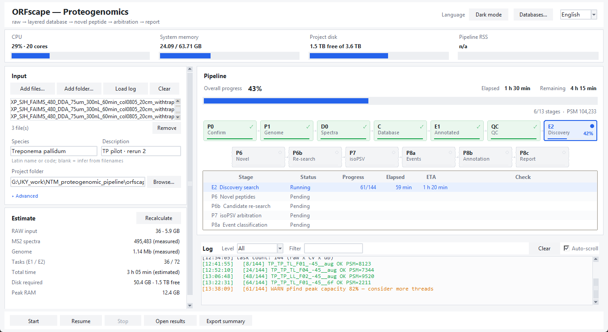

# ORFscape

**ORF + landscape** — a proteogenomics pipeline that lays out the genome's whole
coding *landscape* as a layered ORF database, then uses mass spectra to find which
of those ORFs were actually translated.

Give it a folder of DDA `.raw` files and a species name. It fetches the reference
genome, builds the layered database, searches once against the annotated proteome
and once against the discovery layers, filters novel peptides, arbitrates them
spectrum by spectrum, classifies each event (intergenic / different frame /
antisense / N-terminal extension) and writes figures plus a report.

Prokaryotes run end to end today (P0→P9); eukaryotes get the spliced-protein and
junction-peptide layers (`eukbuild`) with search wiring in progress.



---

## The six layers

| Layer | Content | Built from |
|---|---|---|
| **L0** annotated | reference proteins | GFF/GenBank CDS (spliced per transcript for eukaryotes) |
| **L1** ab initio | predicted ORFs | Prodigal / GeneMarkS-2 / Augustus FASTA dropped into `02_db/<sp>/` |
| **L2** six-frame | all six reading frames, stop-to-stop | genome (eukaryotes: 3 frames per transcript) |
| **L3** N-terminal extension | upstream in-frame starts | annotation + genome |
| **L4/L5** autolysis / contaminant | trypsin self-cleavage, common contaminants | built in |
| **L6** transcript evidence | ORFs inside transcribed regions | RNA-seq (VM: fastp → HISAT2 → StringTie → Prodigal → `orfscape l6map`) |
| *(euk)* junction | peptides spanning exon-exon boundaries | `orfscape eukbuild`, 12 aa each side, `cut%3==0` only |

Every layer carries its own FASTA header prefix (`L1_`, `L2_`, `L3|`, `L6|`), which
is how novel peptides are traced back to the layer that produced them.

## Pipeline

| Stage | Command | Gate (checked automatically) |
|---|---|---|
| P0 data | `scan` | raw > 0, scans > 0 |
| P1 genome | `genome` | fna/gff/faa present and non-empty |
| D0 split | `split` | MGF count == raw count |
| C build | `dbbuild` | L0/L2 non-empty; `L1_coords.tsv` when L1 exists |
| E1 annotated search | `e1` | tasks == MGFs, PSM > 0 |
| QC | `qc`, `qcfigs`, `e1figs` | figures and tables exist |
| E2 discovery search | `e2` | tasks == MGFs × databases, PSM > 0 |
| P6 novel peptides | `novel` | rows > 0; layer-hit pattern matches non-empty layers |
| P6b re-search | `research` | merged ≥ P6; candidate DB ≪ full DB |
| P7 arbitration | `validate` | KEEP > 0; every MISSING has a reason |
| P8 events / annotation | `novgene`, `novannot`, `novreport` | events > 0, nothing unlocated |
| P9 figures | `novelfigs` | funnel and parameter-comparison figures |

`orfscape run` chains all of them in child processes, writes a structured event
stream to `00_logs/progress.jsonl`, and stops on the first failed gate instead of
carrying an empty result forward.

## Requirements

- Python **3.9+** (tested 3.10), `numpy`, `matplotlib`, `python-docx`, `tkinter` (bundled)
- Windows 10/11 for the full experience (the bundled `rawdump`/`rawmethod` are
  Windows binaries and the GUI uses Win32 APIs; the Python package itself is portable)
- pFind 3.1 + pParse, msconvert or ThermoRawFileParser, BLAST+, isoPSV
- Prodigal for the ab initio layer (not bundled — GPL-3; see `orfscape/tools/README.md`)

## Install

```bash
git clone https://github.com/Songhao-Jiang/ORFscape.git
cd ORFscape
python -m orfscape --version          # 0.1.0
python -m orfscape doctor --workdir orfscape_projects/envcheck
```

There is no packaging step yet: run everything from the repository root (or put it
on `PYTHONPATH`). `doctor` writes `env_report.tsv` with every external tool it
found, its version and what is missing.

## Quick start

```bash
# GUI (English by default, switchable to Chinese, dark/light, run plan, ETA)
python -m orfscape gui
python -m orfscape gui --workdir orfscape_projects/<proj>     # replay an existing run

# Whole pipeline, resumable
python -m orfscape run --workdir orfscape_projects/<proj> --raw <raw folder> \
       --species-name "Treponema pallidum" [--from P6 --to P8c] [--skip P6b]

# One stage
python -m orfscape scan --raw <raw folder>
python -m orfscape dbbuild --workdir <proj>
```

The GUI reads only `00_logs/progress.jsonl`, so it can attach to a run started by
the CLI or by an agent, and closing it never stops the run. See `GUI.md` (Chinese).

## Eukaryotes

```bash
python -m orfscape eukbuild --workdir <proj> --sp CREI \
    --fna genome.fna --gff genomic.gff [--transcripts tx.fa] [--ref-protein protein.faa]
python -m orfscape eukbuild --workdir <proj> --preset HSAP      # auto-locates 01_genome/HSAP/
python -m orfscape.checks --workdir <proj> --stage EUK
```

`eukbuild` splices CDS per transcript (reverse-complementing minus-strand genes),
reads the codon table from each transcript's `transl_table` (1/2/3), and emits
`L0_annot.faa`, `L0_junction.faa`, optional `L2_txorf.faa`, `euk_stats.tsv` and a
manifest that validates the result against the reference proteome.

Validated against RefSeq: yeast R64 6,009 proteins (99.92% identical), *C. reinhardtii*
19,525 proteins (99.98%) with 84,606 junction peptides, human 145,213 proteins with
782,122 junction peptides (98.23% exact; 99.22% allowing documented genome-vs-RefSeq
substitutions and non-ATG starts). Search wiring for eukaryotic MS data is not
finished yet (see Limitations).

## Configuration

External tool locations resolve in this order:

1. environment variables — `ORFSCAPE_PFIND`, `ORFSCAPE_ISOPSV`, `ORFSCAPE_BLAST`,
   `ORFSCAPE_BLASTN`, `ORFSCAPE_PDEEP2`, `ORFSCAPE_CONDA`, `ORFSCAPE_MS2PIP`,
   `ORFSCAPE_TOOL_ROOTS` (several roots, `;`-separated);
2. `orfscape/paths.local.json` — copy `orfscape/paths.local.example.json`, git-ignored;
3. common install locations, then `PATH`.

Nothing personal is hard-coded; the repository ships no absolute paths.

## Repository layout

```
ORFscape/
├── orfscape/            package: cli, orchestrator, progress/runlog/estimator,
│                        checks, sysmon, config, core/, gui/, tools/
├── tests/               7 test entries + visual baseline
├── scripts/             result-pack builders (P13 tables/figures/PDF), fetch helpers
├── docs/                GUI manual, screenshots
├── integrations/        agent runbook + ZCode / Claude Code / generic adapters
├── GUI.md               GUI manual (Chinese)
├── README.md · LICENSE · NOTICE · VERSION · CITATION.cff
└── Release_Notes_v0.1.md
```

## Tests

```bash
python tests/test_gui_core.py      # events, ETA, estimator, i18n, log filter, export
python tests/test_gui_state.py     # 120 randomized state-machine rounds × two endings
python tests/gui_theme.py          # light/dark switch, no leaked colours
python tests/gui_visual.py         # pixel regression below the resource strip
python tests/gui_run.py            # plan → cancel → real run
python tests/test_gui_lint.py      # unused-import scan
python tests/test_eukbuild.py      # synthetic +/− strand genes, codon tables, presets
python -m orfscape.checks --workdir <proj> --stage EUK
```

## Limitations (v0.1)

- Eukaryotic **search** is not wired: `eukbuild` produces the layers and the gate,
  but E1/E2 still assume the prokaryotic database layout.
- `LJR|` / `L2|` are not yet in the novel-peptide layer whitelist, and novel
  peptides spanning an intron are not located by transcript coordinates yet.
- BRAKER3 is script generation only (GeneMark-ETP/AUGUSTUS must be installed).
- Prodigal is not bundled; without it the ab initio layer is skipped explicitly.
- Card thresholds are recomputed per run from Tier1 — never compare KEEP counts
  across runs without saying so.

## Agent / agent-shell integration

The same pipeline can be driven by an LLM agent instead of a human. `integrations/`
holds a shell-agnostic runbook plus thin adapters:

| Folder | For |
|---|---|
| `integrations/AGENT_RUNBOOK.md` | any agent: role, order of operations, stop rules, what to report |
| `integrations/scripts/` | `preflight.py`, `stage_check.py`, `run_pipeline.py` (stdlib only) |
| `integrations/zcode/` | ZCode skill + subagent |
| `integrations/claude-code/` | Claude Code subagent + `CLAUDE.md` snippet |
| `integrations/generic/PROMPT.md` | copy-paste system prompt (DeepSeek, GPT, Qwen, …) |

## License

MIT — see `LICENSE`. Third-party components and their terms: `NOTICE`.
If ORFscape contributes to a publication, cite the repository (`CITATION.cff`).

---

# 中文说明

**ORFscape**（ORF + landscape）：把基因组的"编码可能性空间"铺成多层 ORF 库
（注释 / ab initio / 六框或转录本 ORF / N 端延伸 / 转录本证据 / 剪接连接肽），
再用 DDA 质谱把真正翻译出来的 ORF 捞出来，按事件归类并出图出报告。

**当前版本**：v0.1.0（首次公开发布）。原核 P0→P9 全流程可跑；真核已完成剪接蛋白层
与连接肽层（`eukbuild`），搜库接线尚未完成。

**最小用法**

```bash
git clone https://github.com/Songhao-Jiang/ORFscape.git && cd ORFscape
python -m orfscape doctor --workdir orfscape_projects/envcheck     # 环境自检
python -m orfscape gui                                            # 图形界面（英文默认，可切中文）
python -m orfscape run --workdir orfscape_projects/<proj> --raw <raw 目录> \
       --species-name "Treponema pallidum"
```

**六层库**：L0 注释蛋白、L1 ab initio、L2 六框（真核为转录本三框）、L3 N 端延伸、
L4/L5 自切与污染、L6 转录本证据；真核另加剪接连接肽层（`L0_junction`）。

**外部工具**（pFind / isoPSV / BLAST+ / Prodigal…）不随仓库分发，用环境变量或
`orfscape/paths.local.json` 指定；`rawdump`/`rawmethod` 上游无预编译包，已随包提供
（Apache-2.0，见 `NOTICE`）。Prodigal 为 GPL-3，请自行安装。

**已知边界**：真核搜库未接线、跨内含子新肽未定位、BRAKER3 仅生成脚本、卡值每轮重算
跨轮不可比。详见英文部分的 *Limitations*。

许可见 `LICENSE`（MIT）；第三方组件与许可见 `NOTICE`。
